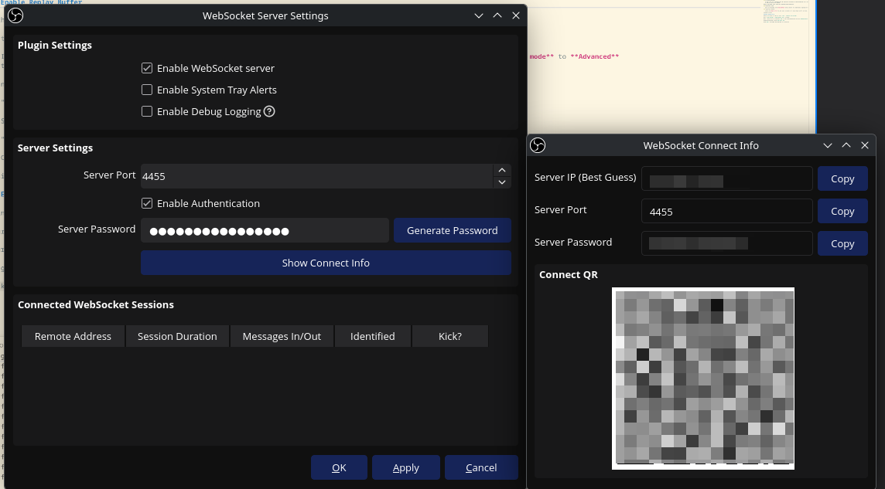

# EDMC PVP Bot OBS Bridge

The EDMC Plugin, as of Version `1.4.0` supports integrating with a locally running OBS instance using the WebSocket Server that can be enabled on newer Versions (v28+).
With this integration, you can **automatically clip** on kills, deaths and on command using a user-defined text command.
Additionally, for clips triggered by kills and deaths you can further **trim** and **rename** them based on the kill specifics.

## Prerequisites

-   **`EDMC_PvP_Bot`** and Version 1.4.0 or higher

    Get it [here](https://gitlab.com/gankers/EDMC-PvPBot/-/releases){target=_blank}. Click on the blue "Download | Release" image / button.

-   **`OBS`** on Version 28 or higher

    Get it [here](https://obsproject.com/){target=_blank} or [here](https://github.com/obsproject/obs-studio/releases){target=_blank}

-   **`ffmpeg`** to be accessible to EDMC / installed on the System (**optional, needed for clip trimming only**).

    Get it [here](https://ffmpeg.org/download.html){target=_blank} and ensure it's on the `$PATH`.

    ??? tip "ffmpeg on Windows (click to open)"

        Its easiest to install ffmpeg not from the official site, but from a repackage:

        Search for the `wt` program on Windows and start it, then paste and run:

        ``` ps
        winget install Gyan.FFmpeg
        ```

        This will install ffmpeg and put it on the `$PATH` (making it discoverable to EDMC).

        You can verify by closing and re-opening `wt` and running

        ``` ps
        ffmpeg -version
        ```

## OBS Setup

### Enable Replay Buffer

Under the hood, all the plugin does it trigger the Save Replay Buffer command on OBS. For Replay Buffers to work, you need to ensure they are enabled and have enough RAM assigned.

With OBS open, select `File` > `Settings` in the top left of the window.

In the settings, select the `Output` Tab on the left.

!!! tip "Recording Settings"

    If this is your first time dabbling with OBS, familiarize yourself with the Recording Settings. Also, consider switching **output mode** to **Advanced**
    to make use of your GPU for Encoding.

The next step depends on your output mode. Select the relevant tab for you:

=== "Output Mode: Simple"

    Scroll all the way down to the **Replay Buffer** section, make sure it is enabled and is long enough to fit our needs

=== "Output Mode: Advanced"

    Click on the **Replay Buffer** Tab, make sure it is enabled and the Maximum Replay Time fits your needs.

Closing the Settings.

### Enable WebSocket Server

Again from the system bar (top left), select `Tools` > `WebSocket Server Settings`

Ensure `Plugin Settings` > `Enable WebSocket server` is enabled.

Ensure a Server Port is set (the default `4455` is fine), enable authentication and click `Generate Password`.

You get the Password by clicking `Show Connect Info`.

It should look something like this:



Click `Apply`. You can keep this window open for the next step.

### Configure the EDMC Plugin

#### Basic

Start EDMC, head to the Settings, find the `EDMC_PvP_Bot` Tab, followed by the `OBS Bridge` Subtab.

!!! warning ""

    The Settings List is quite long. You might need to resize the settings window to fit it all

- Enable `Enable OBS Bridge`
- Set the Port if youre using a different one
- **Set the Websocket Password**

!!! example "Verify"

    Click "OK". The EDMC Plugin will automatically connect (and reconnect) to this WebSocket. It should also automatically enable `Start Replay Buffer`. If you click `Stop Replay Buffer`, you should see it be re-enabled within seconds.

    Additionally, if you still have the WebSocket Settings from OBS up, you should see an Entry under `Connected WebSocket Sessions`. If you kick it, it will automatically reconnect within milliseconds.

    This means that **if you need to change Recording Settings you need to stop EDMC or disable the OBS Bridge in the Settings again**.
    Also, the order of startup doesn't matter. The Plugin is resilient to OBS restarts, late starts, early starts, etc.

Without changing anything else, your clips get automatically clipped.
If that's all you care about, you can stop reading here.

#### Move and Rename Clips

For Kills and Deaths, the Plugin already has a lot of context about the clip that is being saved, making it a sensible candidate for autorenaming clips to give them context about the killer and victim, the time and the location.

To get renaming to work, you must first decide about a `Clip Storage Location`. Select a folder here, preferably **not** the one that OBS uses for its clips.
If you leave this empty, the feature **will not work**

Under `Clip Naming Format` you get to pick what the file name should be.

You get the following variables exposed. You reference a variable by putting it into curly braces.

E.g. `killer` gets referenced as `{killer}` in the input string.

##### Examples

Feel free to just copy paste or adjust any of these examples:

!!! example "Setup"

    Below are some examples. To make it easier to compare, assume that the template shows
    a kill from CMDR `Harry Potter`, flying an `Imperial Clipper` on CMDR `Salomé`, flying a Clipper,
    in `Anumclaw` at `2017-04-29T19:45:00Z`, with CMDR `Harry Potter` being the person running the Plugin.

    Click on the example you like to get its template

??? example "Group by Day: `2017-04-29/Harry_Potter-Salomé-Anumclaw`"

    ```
    {date_yyyy_mm_dd}/{killer_NO_SPACE}-{victim_NO_SPACE}-{system_name_NO_SPACE}
    ```

??? example "Group by System and Date: `Anumclaw/2017-04-29/Harry_Potter-Salomé`"

    ```
    {system_name_NO_SPACE}/{date_yyyy_mm_dd}/{killer_NO_SPACE}-{victim_NO_SPACE}
    ```

??? example "Group by own Ship: `empire_trader/2017-04-29T19:45:00Z`"

    ```
    {self_ship}/{date_rfc3339}
    ```

??? example "Clip Hoarder: `Salomé/2017-04-29/Anumclaw/empire_trader-vs-empire_trader`"

    ```
    {other_party_NO_SPACE}/{date_yyyy_mm_dd}/{system_name_NO_SPACE}/{self_ship}-vs-{other_party_ship}
    ```

##### Variable Reference

| Variable Name          | Description                                                                                                                                                                                                                              | Example                |
| ---------------------- | ---------------------------------------------------------------------------------------------------------------------------------------------------------------------------------------------------------------------------------------- | ---------------------- |
| `killer`               | The Name of the Killer, with any potentially unsafe characters removed                                                                                                                                                                   | `Harry Potter`         |
| `killer_NO_SPACE`      | Same as `killer`, with all spaces replaced with `_`                                                                                                                                                                                      | `Harry_Potter`         |
| `victim`               | The Name of the Victim, with any potentially unsafe characters removed                                                                                                                                                                   | `WDX`                  |
| `victim_NO_SPACE`      | Same as `victim`, with all spaces replaced with `_`                                                                                                                                                                                      | `WDX`                  |
| `other_party`          | The name of other CMDR                                                                                                                                                                                                                   | `WDX`                  |
| `other_party_NO_SPACE` | Same as `other_party`, with all spaces replaced with `_`                                                                                                                                                                                 | `WDX`                  |
| `system_name`          | The Name of the System, with any potentially unsafe characters removed                                                                                                                                                                   | `Shinrarta Dezhra`     |
| `system_name_NO_SPACE` | Same as `system_name`, with all spaces replaced with `_`                                                                                                                                                                                 | `Shinrarta_Dezhra`     |
| `system_id`            | The System's ID. Is always a positive number between 0 and 2⁶⁴, hence always safe to use.                                                                                                                                                | `3932277478106`        |
| `date_yyyy_mm_dd`      | The Day of the kill, using `YYYY-MM-DD`                                                                                                                                                                                                  | `2026-11-08`           |
| `date_rfc3339`         | The Instant of the Kill, using the [RFC3339](https://rfc-explained.com/en/3339){target=_blank}, using Zulu/UTC+0 time, with **double colons replaced with dashes**                                                                       | `2026-11-08T13-17-43Z` |
| `killer_ship`          | The **internal** name of the killer's ship, `unknown` if missing [see `get_pretty_names_for_ship_ids` as reference](https://gitlab.com/gankers/gankers-backend/-/blob/main/model/src/ship_names.rs?ref_type=heads){target=_blank}        | `python_nx`, `unknown` |
| `victim_ship`          | The **internal** name of the victim's ship, `unknown` if missing [see `get_pretty_names_for_ship_ids` as reference](https://gitlab.com/gankers/gankers-backend/-/blob/main/model/src/ship_names.rs?ref_type=heads){target=_blank}        | `type8`, `unknown`     |
| `self_ship`            | The **internal** name of the plugin runner's ship, `unknown` if missing [see `get_pretty_names_for_ship_ids` as reference](https://gitlab.com/gankers/gankers-backend/-/blob/main/model/src/ship_names.rs?ref_type=heads){target=_blank} | `python_nx`, `unknown` |
| `other_party_ship`     | The **internal** name of the other party's ship, `unknown` if missing [see `get_pretty_names_for_ship_ids` as reference](https://gitlab.com/gankers/gankers-backend/-/blob/main/model/src/ship_names.rs?ref_type=heads){target=_blank}   | `python_nx`, `unknown` |

##### Template Rules

- **Subpaths are allows**. Use forward slashes, even on Windows
- **Escaping Clip Storage Location is forbidden**. If you use relative paths and absolute paths that cause the effective path to be resolved outside the configured `Clip Storage Location`, the move / rename will be aborted
- **No file extensions**. You template should not define a file extension. The extension from the source file is taken and appended.
- **Name collisions are handled**. If you use something like `{killer}-{victim}`, this will cause the first file to be named `killerName-victimName.mp4`. Subsequent collisions enumerate at the end: `killerName-victimName_2.mp4`, `killerName-victimName_3.mp4`, etc.

#### Autotrim

If you declared a storage location, trimming can be used. This will trim the clip based **on the last time you dropped from SC**.

Using `Offset the Checkpoint` you can adjust the clip start. Using a negative value makes the clip longer (you keep the SC drop), using a positive makes it shorter (you miss part of the drop.)
The values are in milliseconds, hence `-2000` starts the clip 2 seconds earlier.

!!! tip ""

    Keep in mind that events are written after the fact, so if you want to have the Drop on video, use something like -2000.
